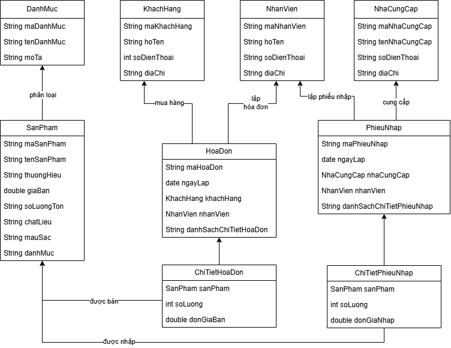
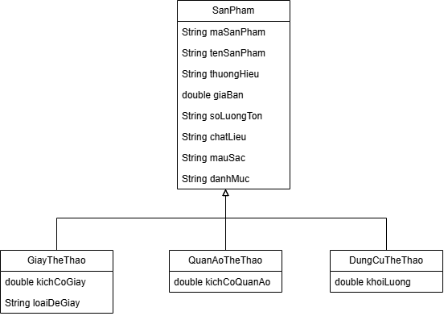

# Quản lý cửa hàng dụng cụ thể thao

Đồ án **lập trình hướng đối tượng (OOP)** bằng **Java**, mô phỏng việc quản lý sản phẩm, khách hàng, nhân viên, nhà cung cấp, hóa đơn bán hàng và phiếu nhập.

## 1. Class diagram

| Sơ đồ                                                       | Nội dung                                     |
| ----------------------------------------------------------- | -------------------------------------------- |
| [Class diagram tổng quan](diagrams/class-diagram.png)       | Các thực thể và mối quan hệ quản lý cửa hàng |
| [Kế thừa và đa hình](diagrams/inheritance-polymorphism.png) | Lớp cha `SanPham` và các lớp con             |

Có thể mở file nguồn `class-diagram.drawio` bằng [diagrams.net](https://app.diagrams.net/) khi file đó được thêm vào repository. Hiện repository lưu hai ảnh sơ đồ trong thư mục `diagrams/`.

### Các class trên sơ đồ

| Nhóm      | Class              | Thuộc tính / vai trò chính                                                |
| --------- | ------------------ | ------------------------------------------------------------------------- |
| Sản phẩm  | `SanPham`          | `maSanPham`, `tenSanPham`, `thuongHieu`, `giaBan`, `soLuongTon`, `maLoai` |
| Sản phẩm  | `GiayTheThao`      | `kichCoGiay`, `mauSac`, `loaiDeGiay`                                      |
| Sản phẩm  | `DungCuTheThao`    | `monTheThao`, `vatLieu`, `khoiLuong`                                      |
| Phân loại | `LoaiSanPham`      | `maLoai`, `tenLoai`, `moTa`                                               |
| Đối tượng | `KhachHang`        | `maKhachHang`, `hoTen`, `soDienThoai`, `diaChi`                           |
| Đối tượng | `NhanVien`         | `maNhanVien`, `hoTen`, `soDienThoai`, `diaChi`                            |
| Đối tượng | `NhaCungCap`       | `maNhaCungCap`, `tenNhaCungCap`, `soDienThoai`, `diaChi`                  |
| Bán hàng  | `HoaDon`           | Mã hóa đơn, ngày lập, mã khách hàng, mã nhân viên, chi tiết hóa đơn       |
| Bán hàng  | `ChiTietHoaDon`    | `sanPham`, `soLuong`, `donGiaBan`                                         |
| Nhập hàng | `PhieuNhap`        | Mã phiếu, ngày lập, mã nhà cung cấp, mã nhân viên, chi tiết phiếu nhập    |
| Nhập hàng | `ChiTietPhieuNhap` | `sanPham`, `soLuong`, `donGiaNhap`                                        |

**Tổng cộng 11 class được đặt tên trong hai trang sơ đồ hiện tại.** Sơ đồ không định nghĩa interface hay enum.

### Các quan hệ chính

- `GiayTheThao` và `DungCuTheThao` **kế thừa** `SanPham`.
- `SanPham` được phân loại bởi `LoaiSanPham`.
- `KhachHang` mua hàng; `NhanVien` lập `HoaDon`; `HoaDon` có các `ChiTietHoaDon` liên kết với sản phẩm.
- `NhaCungCap` cung cấp hàng; `NhanVien` lập `PhieuNhap`; `PhieuNhap` có các `ChiTietPhieuNhap` liên kết với sản phẩm.

## 2. Cấu trúc repository hiện tại

```text
.
├── README.md
├── SanPham.java
├── DungCuTheThao.java
├── QuanAoTheThao.java
├── diagrams/
│   ├── class-diagram.png
│   └── inheritance-polymorphism.png
├── docs/
├── artifacts/
└── pictures/
```

| File Java            | Tình trạng triển khai                                                                                                  |
| -------------------- | ---------------------------------------------------------------------------------------------------------------------- |
| `SanPham.java`       | Có thuộc tính `private`, constructor, getter/setter. Hiện **chưa phải abstract class** và chưa có phương thức đa hình. |
| `DungCuTheThao.java` | Đã `extends SanPham`, sử dụng `super(...)`, có thuộc tính và getter/setter riêng.                                      |
| `QuanAoTheThao.java` | Đã `extends SanPham`, nhưng thuộc tính `kichCoGiay`, `loaiDeGiay` hiện giống lớp giày; **chưa đồng bộ với sơ đồ**.     |
| `GiayTheThao.java`   | Có trên class diagram nhưng **chưa được tạo** trong repository.                                                        |

Các class nghiệp vụ khác hiện vẫn là thiết kế, chưa có file Java tương ứng.

## 3. Nguyên lý OOP

- **Đóng gói (Encapsulation):** Khai báo thuộc tính `private`; dùng constructor/getter/setter để truy cập khi cần.
- **Kế thừa (Inheritance):** Các lớp chuyên biệt `extends SanPham` và sử dụng `super(...)`.
- **Đa hình (Polymorphism) — cần triển khai:** Bổ sung một phương thức chung ở `SanPham` (chẳng hạn `moTaChiTiet()`) và ghi đè bằng `@Override` ở các lớp con; gọi qua tham chiếu kiểu `SanPham`.
- **Trừu tượng (Abstraction) — có thể bổ sung:** Chuyển `SanPham` thành `abstract class` nếu thiết kế yêu cầu không khởi tạo sản phẩm chung trực tiếp. Đây **chưa phải trạng thái code hiện tại**.

## 4. Kế hoạch hoàn thiện

1. Thống nhất sơ đồ và mã nguồn: tạo `GiayTheThao.java`; điều chỉnh `QuanAoTheThao.java` cho đúng thuộc tính và bổ sung vào sơ đồ nếu giữ lớp này.
2. Rà soát kiểu dữ liệu: sơ đồ ghi `String soLuongTon` trong khi Java dùng `int`; thông tin số điện thoại nên lưu bằng `String` để giữ số 0 đầu.
3. Lập trình `LoaiSanPham`, `KhachHang`, `NhanVien`, `NhaCungCap`, `HoaDon`, `ChiTietHoaDon`, `PhieuNhap`, `ChiTietPhieuNhap` (mỗi `public class` một file).
4. Bổ sung các phương thức nghiệp vụ, kiểm thử kế thừa và đa hình.
5. Tạo `Main.java` để chạy thử chương trình và bổ sung hướng dẫn chạy thực tế.

## 5. Class Diagram 
- Đây là sơ đồ tổng quan về các class trong chương trình.


- Đây là sơ đồ thể hiện quan hệ kế thừa và đa hình giữa các class.


