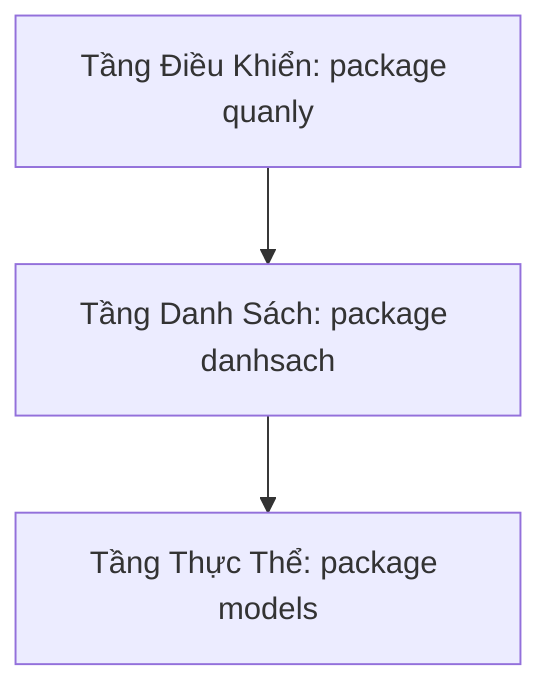

# Báo Cáo Chi Tiết Các Đặc Trưng Hướng Đối Tượng (OOP) Trong Đồ Án
> **Chuyên đề**: Kế Thừa (Inheritance) - Đa Hình (Polymorphism) - Interface - Biến Tĩnh (Static)

---

## I. Tổng Quan Kiến Trúc 3 Tầng Của Đồ Án

Kiến trúc đồ án được phân chia thành 3 package riêng biệt theo đúng mô hình chuẩn của Giảng viên yêu cầu:



1. **Package `models` (Class đơn / Entity)**: Chứa các lớp thực thể đại diện cho dữ liệu kinh doanh (Sản phẩm, Hóa đơn, Khách hàng...).
2. **Package `danhsach` (Class danh sách / Data Layer)**: Quản lý tập hợp mảng/danh sách đối tượng (`ds`), đảm nhận việc thêm/sửa/xóa/tìm kiếm và lưu trữ file.
3. **Package `quanly` (Class quản lý / Controller)**: Xử lý menu Console, nhập xuất dữ liệu từ bàn phím và điều hướng chương trình.

---

## II. Đặc Tính: Kế Thừa (Inheritance)

Kế thừa cho phép các lớp con tái sử dụng các thuộc tính và phương thức từ lớp cha, đồng thời mở rộng thêm các thuộc tính chuyên biệt mà không cần viết lại mã nguồn.

### 1. Kế thừa trong tầng `models` (Mô hình Sản phẩm)

* **Lớp cha**: [`src/models/SanPham.java`](file:///c:/Users/KYVY/oop_26/src/models/SanPham.java) (Lớp trừu tượng `abstract class`)
  * Đóng gói các thuộc tính dùng chung của mọi sản phẩm: `maSanPham`, `tenSanPham`, `thuongHieu`, `giaBan`, `soLuongTon`, `loaiSP`.
  * Khai báo phương thức trừu tượng: `public abstract String hienThiThongTin();`.
* **Lớp con 1**: [`src/models/GiayTheThao.java`](file:///c:/Users/KYVY/oop_26/src/models/GiayTheThao.java)
  * Khai báo: `public class GiayTheThao extends SanPham`
  * Tái sử dụng constructor và dữ liệu lớp cha qua `super(...)`.
  * Mở rộng thuộc tính chuyên biệt cho giày: `kichCoGiay`, `mauSac`, `chatLieu`, `loaiDeGiay`.
* **Lớp con 2**: [`src/models/DungCuTheThao.java`](file:///c:/Users/KYVY/oop_26/src/models/DungCuTheThao.java)
  * Khai báo: `public class DungCuTheThao extends SanPham`
  * Tái sử dụng constructor và dữ liệu lớp cha qua `super(...)`.
  * Mở rộng thuộc tính chuyên biệt cho dụng cụ: `monTheThao`, `vatLieu`, `khoiLuongKg`.

### 2. Kế thừa trong tầng `quanly` (Bộ điều khiển Menu Console)

* **Lớp cha**: [`src/quanly/QuanLyCuaHang.java`](file:///c:/Users/KYVY/oop_26/src/quanly/QuanLyCuaHang.java)
  * Đóng vai trò lớp khung (Base Controller), lưu trữ tập trung dữ liệu toàn cục (`static DanhSach...`) và các hàm tiện ích nhập liệu chuẩn (`nhapChuoi()`, `nhapSoNguyen()`, `nhapNgay()`).
  * Khai báo phương thức khung `public void menuChinh()`.
* **Các lớp con kế thừa**:
  * [`src/quanly/QuanLySanPham.java`](file:///c:/Users/KYVY/oop_26/src/quanly/QuanLySanPham.java) `extends QuanLyCuaHang`: Menu nhập, sửa, xóa, tìm sản phẩm.
  * [`src/quanly/QuanLyLoaiSP.java`](file:///c:/Users/KYVY/oop_26/src/quanly/QuanLyLoaiSP.java) `extends QuanLyCuaHang`: Menu quản lý loại hàng thể thao.
  * [`src/quanly/QuanLyKhachHang.java`](file:///c:/Users/KYVY/oop_26/src/quanly/QuanLyKhachHang.java) `extends QuanLyCuaHang`: Menu quản lý khách hàng.
  * [`src/quanly/QuanLyNhanVien.java`](file:///c:/Users/KYVY/oop_26/src/quanly/QuanLyNhanVien.java) `extends QuanLyCuaHang`: Menu quản lý nhân viên.
  * [`src/quanly/QuanLyNhaCungCap.java`](file:///c:/Users/KYVY/oop_26/src/quanly/QuanLyNhaCungCap.java) `extends QuanLyCuaHang`: Menu quản lý nhà cung cấp.
  * [`src/quanly/QuanLyHoaDon.java`](file:///c:/Users/KYVY/oop_26/src/quanly/QuanLyHoaDon.java) `extends QuanLyCuaHang`: Lập hóa đơn và chi tiết hóa đơn.
  * [`src/quanly/QuanLyPhieuNhap.java`](file:///c:/Users/KYVY/oop_26/src/quanly/QuanLyPhieuNhap.java) `extends QuanLyCuaHang`: Lập phiếu nhập kho và chi tiết phiếu nhập.

---

## III. Đặc Tính: Giao Diện (Interface)

Interface định nghĩa một chuẩn hành vi (Contract) mà các lớp danh sách bắt buộc phải thực thi đầy đủ.

### 1. File định nghĩa Interface

* File: [`src/danhsach/IQuanLyDanhSach.java`](file:///c:/Users/KYVY/oop_26/src/danhsach/IQuanLyDanhSach.java)
* Khai báo Generic: `public interface IQuanLyDanhSach<T>`
* Bộ quy tắc CRUD tiêu chuẩn:
  ```java
  boolean them(T doiTuong);
  boolean sua(String ma, T moi);
  boolean xoa(String ma);
  T[] timKiem(String tuKhoa);
  ```

### 2. Các File cài đặt (implements) Interface

Tất cả các lớp danh sách trong package `danhsach` đều cài đặt Interface này:

* [`src/danhsach/DanhSachSanPham.java`](file:///c:/Users/KYVY/oop_26/src/danhsach/DanhSachSanPham.java) `implements IQuanLyDanhSach<SanPham>`
* [`src/danhsach/DanhSachLoaiSP.java`](file:///c:/Users/KYVY/oop_26/src/danhsach/DanhSachLoaiSP.java) `implements IQuanLyDanhSach<LoaiSP>`
* [`src/danhsach/DanhSachKhachHang.java`](file:///c:/Users/KYVY/oop_26/src/danhsach/DanhSachKhachHang.java) `implements IQuanLyDanhSach<KhachHang>`
* [`src/danhsach/DanhSachNhanVien.java`](file:///c:/Users/KYVY/oop_26/src/danhsach/DanhSachNhanVien.java) `implements IQuanLyDanhSach<NhanVien>`
* [`src/danhsach/DanhSachNhaCungCap.java`](file:///c:/Users/KYVY/oop_26/src/danhsach/DanhSachNhaCungCap.java) `implements IQuanLyDanhSach<NhaCungCap>`
* [`src/danhsach/DanhSachHoaDon.java`](file:///c:/Users/KYVY/oop_26/src/danhsach/DanhSachHoaDon.java) `implements IQuanLyDanhSach<HoaDon>`
* [`src/danhsach/DanhSachPhieuNhap.java`](file:///c:/Users/KYVY/oop_26/src/danhsach/DanhSachPhieuNhap.java) `implements IQuanLyDanhSach<PhieuNhap>`

> [!NOTE]
> **Ý nghĩa thực tế**: Đảm bảo sự nhất quán. Dù thao tác trên đối tượng nào thì tầng quản lý chỉ cần gọi `.them()`, `.sua()`, `.xoa()`, `.timKiem()`.

---

## IV. Đặc Tính: Đa Hình (Polymorphism)

Đồ án triển khai đầy đủ cả **4 khía cạnh** của tính đa hình trong Java:

### 1. Đa hình lúc chạy qua Ghi đè (Runtime Polymorphism - Method Overriding)

* **Trong tầng Thực thể (`models`)**:
  * Phương thức cha: `public abstract String hienThiThongTin()` tại [`SanPham.java`](file:///c:/Users/KYVY/oop_26/src/models/SanPham.java#L48).
  * Lớp con [`GiayTheThao.java`](file:///c:/Users/KYVY/oop_26/src/models/GiayTheThao.java#L47): Ghi đè `@Override` bổ sung size giày, màu sắc, đế giày.
  * Lớp con [`DungCuTheThao.java`](file:///c:/Users/KYVY/oop_26/src/models/DungCuTheThao.java#L46): Ghi đè `@Override` bổ sung môn thi đấu, chất liệu, cân nặng.
  * **Cơ chế hoạt động**: Khi duyệt mảng `SanPham[] mang`, chỉ cần gọi `sp.hienThiThongTin()`, máy ảo Java (JVM) sẽ tự động dựa vào đối tượng thực tế lúc chạy (`GiayTheThao` hay `DungCuTheThao`) để gọi đúng hàm tương ứng mà không cần `if-else` hay `instanceof`.

* **Trong tầng Quản lý (`quanly`)**:
  * Lớp cha [`QuanLyCuaHang.java`](file:///c:/Users/KYVY/oop_26/src/quanly/QuanLyCuaHang.java#L50) khai báo `public void menuChinh()`.
  * Các lớp con (`QuanLySanPham`, `QuanLyHoaDon`...) ghi đè `@Override public void menuChinh()` để thực hiện nghiệp vụ riêng của từng màn hình.

### 2. Đa hình lúc chạy qua Biến tham chiếu lớp cha (Upcasting & Dynamic Binding)

* File: [`src/quanly/HeThong.java`](file:///c:/Users/KYVY/oop_26/src/quanly/HeThong.java#L10)
* Khai báo duy nhất 1 biến tham chiếu lớp cha:
  ```java
  private QuanLyCuaHang quanLy;
  ```
* Khi người dùng chọn chức năng, biến `quanLy` được gán động sang các lớp con tương ứng:
  ```java
  switch (chon) {
      case 1 -> { quanLy = new QuanLySanPham(); quanLy.menuChinh(); }
      case 2 -> { quanLy = new QuanLyLoaiSP(); quanLy.menuChinh(); }
      case 3 -> { quanLy = new QuanLyKhachHang(); quanLy.menuChinh(); }
      case 6 -> { quanLy = new QuanLyHoaDon(); quanLy.menuChinh(); }
  }
  ```
* **Lợi ích**: Code ngắn gọn, mở rộng tính năng mới dễ dàng mà không làm ảnh hưởng đến luồng chính.

### 3. Đa hình qua Interface

* Sử dụng biến Interface để tiếp nhận thực thể:
  ```java
  IQuanLyDanhSach<LoaiSP> iLoai = new DanhSachLoaiSP();
  iLoai.them(loaiMoi);
  iLoai.timKiem("The Thao");
  ```
* Lớp gọi hàm hoàn toàn độc lập với chi tiết cài đặt mảng hay danh sách bên trong.

### 4. Đa hình lúc biên dịch qua Nạp chồng (Compile-time Polymorphism - Method Overloading)

* **Nạp chồng hàm `timKiem`** trong [`src/danhsach/DanhSachSanPham.java`](file:///c:/Users/KYVY/oop_26/src/danhsach/DanhSachSanPham.java#L64-L73):
  * `public SanPham[] timKiem(String tuKhoa)`: Tìm kiếm gần đúng theo mã hoặc tên sản phẩm.
  * `public SanPham[] timKiem(BigDecimal tu, BigDecimal den)`: Tìm kiếm lọc sản phẩm theo khoảng giá bán.
* **Nạp chồng hàm `thongKeTongTien`** trong [`src/danhsach/DanhSachHoaDon.java`](file:///c:/Users/KYVY/oop_26/src/danhsach/DanhSachHoaDon.java#L87-L97) và [`DanhSachPhieuNhap.java`](file:///c:/Users/KYVY/oop_26/src/danhsach/DanhSachPhieuNhap.java):
  * `public BigDecimal thongKeTongTien()`: Tính tổng doanh thu toàn bộ lịch sử.
  * `public BigDecimal thongKeTongTien(LocalDate tuNgay, LocalDate denNgay)`: Tính tổng doanh thu trong khoảng ngày cụ thể.

---

## V. Đặc Tính: Dữ Liệu Tĩnh (Static) - Tính Duy Nhất

Để đáp ứng yêu cầu của Giảng viên về tính **duy nhất** (Singleton dataset) trong ứng dụng Console:

* File: [`src/quanly/QuanLyCuaHang.java`](file:///c:/Users/KYVY/oop_26/src/quanly/QuanLyCuaHang.java#L12-L24)
* Các trường tĩnh:
  ```java
  protected static DanhSachSanPham dsSanPham = new DanhSachSanPham();
  protected static DanhSachLoaiSP dsLoaiSP = new DanhSachLoaiSP();
  protected static DanhSachKhachHang dsKhachHang = new DanhSachKhachHang();
  protected static DanhSachNhanVien dsNhanVien = new DanhSachNhanVien();
  protected static DanhSachNhaCungCap dsNhaCungCap = new DanhSachNhaCungCap();
  protected static DanhSachHoaDon dsHoaDon = new DanhSachHoaDon();
  protected static DanhSachPhieuNhap dsPhieuNhap = new DanhSachPhieuNhap();
  protected static Kho kho = new Kho(dsSanPham);
  public static final Scanner sc = new Scanner(System.in, "UTF-8");
  ```
* **Ý nghĩa & Ưu điểm**:
  1. **Đồng bộ dữ liệu tức thì**: Suốt thời gian chương trình chạy, toàn bộ hệ thống chỉ có đúng 1 bộ dữ liệu lưu trong RAM. Khi `QuanLySanPham` thêm sản phẩm mới thì `QuanLyHoaDon` và `QuanLyPhieuNhap` nhìn thấy ngay lập tức mà không cần truyền biến qua lại.
  2. **An toàn tài nguyên**: Biến `Scanner sc` duy nhất ngăn chặn lỗi tràn bộ đệm hay rò rỉ tài nguyên luồng bàn phím `System.in`.

---

## VI. Bảng Tổng Hợp Tra Cứu Nhanh Cho Báo Cáo

| STT | Khái niệm OOP | Vị trí File | Đoạn mã tiêu biểu |
| :---: | :--- | :--- | :--- |
| **1** | **Kế thừa (Models)** | [`GiayTheThao.java`](file:///c:/Users/KYVY/oop_26/src/models/GiayTheThao.java#L7)<br>[`DungCuTheThao.java`](file:///c:/Users/KYVY/oop_26/src/models/DungCuTheThao.java#L7) | `public class GiayTheThao extends SanPham`<br>`public class DungCuTheThao extends SanPham` |
| **2** | **Kế thừa (Quản lý)** | [`QuanLySanPham.java`](file:///c:/Users/KYVY/oop_26/src/quanly/QuanLySanPham.java#L9) | `public class QuanLySanPham extends QuanLyCuaHang` |
| **3** | **Interface** | [`IQuanLyDanhSach.java`](file:///c:/Users/KYVY/oop_26/src/danhsach/IQuanLyDanhSach.java#L3)<br>[`DanhSachSanPham.java`](file:///c:/Users/KYVY/oop_26/src/danhsach/DanhSachSanPham.java#L7) | `public interface IQuanLyDanhSach<T>`<br>`implements IQuanLyDanhSach<SanPham>` |
| **4** | **Đa hình Overriding** | [`GiayTheThao.java`](file:///c:/Users/KYVY/oop_26/src/models/GiayTheThao.java#L47)<br>[`QuanLySanPham.java`](file:///c:/Users/KYVY/oop_26/src/quanly/QuanLySanPham.java#L11) | `@Override public String hienThiThongTin()`<br>`@Override public void menuChinh()` |
| **5** | **Đa hình Upcasting** | [`HeThong.java`](file:///c:/Users/KYVY/oop_26/src/quanly/HeThong.java#L10) | `private QuanLyCuaHang quanLy;`<br>`quanLy = new QuanLySanPham(); quanLy.menuChinh();` |
| **6** | **Đa hình Overloading** | [`DanhSachSanPham.java`](file:///c:/Users/KYVY/oop_26/src/danhsach/DanhSachSanPham.java#L64)<br>[`DanhSachHoaDon.java`](file:///c:/Users/KYVY/oop_26/src/danhsach/DanhSachHoaDon.java#L87) | `timKiem(String)` & `timKiem(BigDecimal, BigDecimal)`<br>`thongKeTongTien()` & `thongKeTongTien(LocalDate, LocalDate)` |
| **7** | **Dữ liệu tĩnh (Static)** | [`QuanLyCuaHang.java`](file:///c:/Users/KYVY/oop_26/src/quanly/QuanLyCuaHang.java#L12) | `protected static DanhSachSanPham dsSanPham;`<br>`public static final Scanner sc;` |
