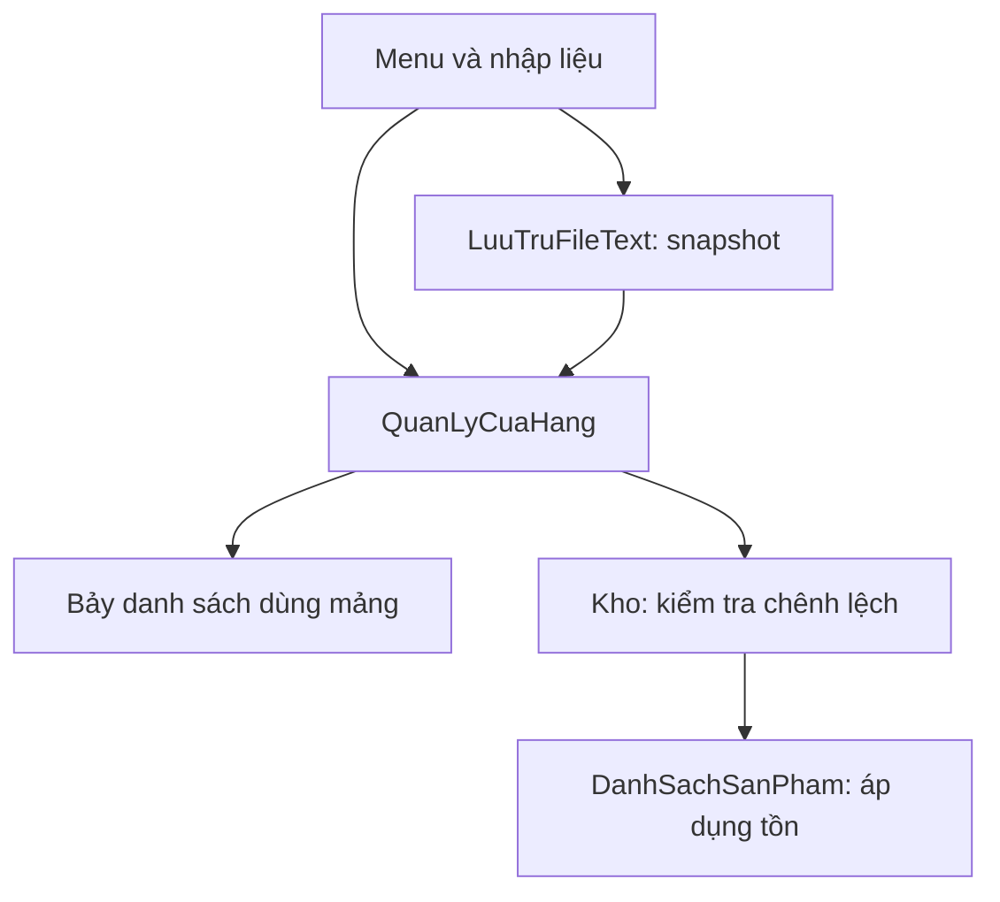
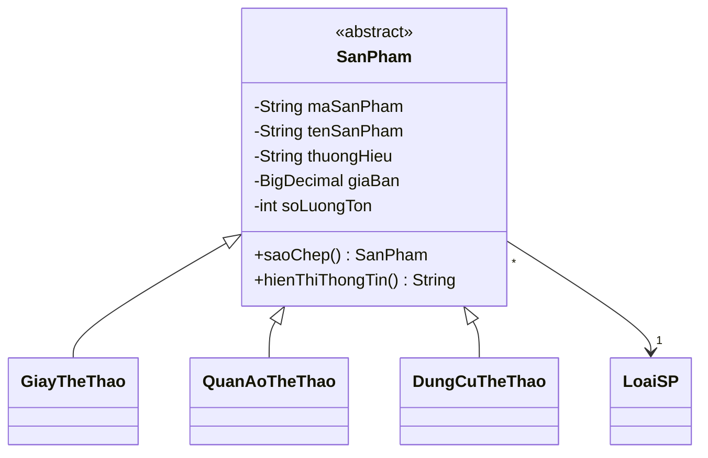

# Thiết kế Sport Store hiện tại

Phiên bản này triển khai yêu cầu gốc tối thiểu 15 class và phương án 23 class + interface trong các tài liệu nguồn. Các lớp hỗ trợ giao diện, kiểm tra, đọc định dạng cũ được tách thêm để mỗi lớp có trách nhiệm rõ ràng. Không dùng số class làm mục tiêu để gộp tất cả vào một lớp quản lý khổng lồ.

## Các lớp

| Nhóm | Class | Trách nhiệm |
| --- | --- | --- |
| Thực thể (12) | `SanPham`, `GiayTheThao`, `QuanAoTheThao`, `DungCuTheThao`, `LoaiSP`, `KhachHang`, `NhanVien`, `NhaCungCap`, `HoaDon`, `ChiTietHoaDon`, `PhieuNhap`, `ChiTietPhieuNhap` | Lưu trạng thái một đối tượng, kiểm tra giá trị, tính tiền và thao tác chi tiết |
| Danh sách (7) | `DanhSachSanPham`, `DanhSachLoaiSP`, `DanhSachKhachHang`, `DanhSachNhanVien`, `DanhSachNhaCungCap`, `DanhSachHoaDon`, `DanhSachPhieuNhap` | Mỗi lớp giữ `ds` kiểu mảng và `soLuong`; CRUD, tìm kiếm; hai danh sách chứng từ có thống kê |
| Điều phối/hỗ trợ chính (4) | `QuanLyCuaHang`, `Kho`, `LuuTruFileText`, `Main` | Điều kiện liên kết, giao dịch tồn, đọc/ghi, khởi chạy |
| Hỗ trợ bổ sung (4) | `KiemTra`, `FileText`, `BoMaSanPham`, `NhapDuLieuCu` | Kiểm tra dùng chung, escape/atomic file, tuần tự hóa lớp con, nhập dữ liệu cũ |
| Giao diện (5) | `NhapLieuConsole`, `MenuDanhSach`, `MenuCuaHang`, `NhapSanPham`, `NhapChungTu` | Nhập liệu, điều hướng, menu dùng chung và soạn từng loại đối tượng |
| Interface (1) | `IQuanLyDanhSach<T>` | Thống nhất `them`, `sua`, `xoa`, `timTheoMa`, `timKiem`, `getTatCa`, `getSoLuong` |

Tổng: **32 class và 1 interface** trong `src/`. Constructor không tham số của thực thể tạo bản chưa hoàn chỉnh; danh sách từ chối lưu khi thiếu dữ liệu bắt buộc. Đối tượng thực tế được tạo bằng constructor có tham số. Lớp có phụ thuộc bắt buộc như `Kho` nhận danh sách qua constructor; không tạo một kho rời không liên kết.

## Tách trách nhiệm

Thực thể không biết menu hoặc đường dẫn file. Danh sách không tự cập nhật Kho và không tự ghi file sau từng setter. `MenuDanhSach<T>` thực sự sử dụng interface để đọc dữ liệu; các callback ghi gọi qua `QuanLyCuaHang` để giữ kiểm tra tham chiếu. Getter của facade trả bản sao danh sách; không thể lấy danh sách để bán hàng mà bỏ qua kho.

## Sản phẩm và đa hình

Kích cỡ giày là `double > 0`; kích cỡ quần áo là chuỗi. Màu sắc/chất liệu nằm ở hai lớp giày và quần áo; môn thể thao/vật liệu/khối lượng nằm ở dụng cụ. Mỗi mã SP là một biến thể hàng hóa cụ thể. Duyệt `SanPham[]` gọi `hienThiThongTin()` và `saoChep()` qua lớp cơ sở để thể hiện đa hình. Kiểm tra kiểu chỉ dùng tại nhập liệu/tuần tự hóa để tạo đúng lớp con; Kho không rẽ nhánh theo loại giày/quần áo/dụng cụ.

## Quy tắc chứng từ và tồn

| Thao tác | Hóa đơn | Phiếu nhập |
| --- | --- | --- |
| Thêm | `0 - số mới` | `số mới - 0` |
| Sửa | `số cũ - số mới` | `số mới - số cũ` |
| Xóa | `số cũ - 0` | `0 - số cũ` |

Với từng mã SP, `tồn sau = tồn hiện tại + chênh lệch`. Một phía không có mã đó được xem là số lượng 0.

1. Chuẩn hóa mã, kiểm tra đối tác/nhân viên/sản phẩm tồn tại; chứng từ mới phải có chi tiết.
2. Dựng bản sao danh sách chứng từ mới, kiểm tra mã trùng và mã không đổi.
3. Kho tính chênh lệch trên tất cả dòng cũ/mới bằng `long`, kiểm tra không âm và không vượt `int`.
4. Danh sách SP dựng đầy đủ mảng có tồn mới rồi mới thay tham chiếu mảng.
5. Gán danh sách chứng từ mới. Sau thời điểm cập nhật tồn không còn bước kiểm tra nghiệp vụ có thể thất bại.

Thiếu hàng tại dòng sau không làm dòng trước bị trừ tồn. Sửa/xóa phiếu nhập bị từ chối nếu làm âm tồn. Không dùng tổng tiền bán trừ tổng tiền nhập làm lợi nhuận.

Đối tượng đầu vào/đầu ra và dòng chi tiết đều được sao chép để việc sửa một bản đang soạn không làm mất bản cũ. Liên kết nghiệp vụ được xác định bằng mã; khi nhận chứng từ, facade tra lại dữ liệu hiện hành và tạo lại liên kết. Các bản sao nằm trong chứng từ không dùng để cập nhật dữ liệu gốc. Hiển thị và tìm chứng từ dùng mã đối tác/mã SP; thay đổi tên trong danh mục chính không ảnh hưởng phép tính lịch sử.

## File text

`SPORT_STORE_V2` là tiêu đề. Các loại dòng:

| Nhãn | Các cột sau nhãn |
| --- | --- |
| `LOAI` | mã loại, tên, mô tả |
| `KH` | mã khách, tên, điện thoại, địa chỉ |
| `NV` | mã nhân viên, tên, điện thoại, ca |
| `NCC` | mã NCC, tên, điện thoại, địa chỉ |
| `SP` | kiểu lớp con, mã, tên, thương hiệu, giá bán, tồn, mã loại, thuộc tính riêng |
| `HD` / `PN` | mã chứng từ, ngày, mã đối tác, mã nhân viên |
| `CTHD` / `CTPN` | mã chứng từ, mã SP, số lượng, đơn giá lịch sử |

Dòng SP có phần riêng: giày = kích cỡ/màu/chất liệu/đế; quần áo = cỡ/màu/chất liệu; dụng cụ = môn/vật liệu/khối lượng kg. Tab phân cột; `\\`, `\t`, `\n`, `\r` biểu diễn ký tự đặc biệt. Tiền là chuỗi thập phân; ngày ISO `yyyy-MM-dd`.

Đọc theo nhiều lượt: loại/người → sản phẩm → đầu chứng từ → chi tiết. Mọi dữ liệu được dựng vào cửa hàng mới; nếu lỗi thì không trả về một cửa hàng nạp nửa chừng. Khôi phục tồn đã lưu, không gọi giao dịch Kho. Dùng một file để thay nguyên tử đồng thời cả kho và chứng từ; đây là lựa chọn triển khai thay cho phương án gợi ý 9 file trong tài liệu hướng dẫn.

Định dạng cũ chỉ hỗ trợ đúng các header và bản nháp rỗng đang có trong repo. Không đoán định dạng khác. Các file cũ vẫn giữ nguyên byte; snapshot V2 chỉ chứa các thuộc tính của model hiện tại. Có lỗi khởi động thì không chạy menu và không lưu đè. Không hỗ trợ nhiều tiến trình cùng sửa chung một thư mục dữ liệu.

## Đối chiếu tiêu chí chấm điểm

| Tiêu chí | Vị trí thực hiện |
| --- | --- |
| Ít nhất 15 class | 32 class trong `src/` |
| Constructor | Thực thể/danh sách có không tham số và có tham số; lớp hạ tầng nhận phụ thuộc hoặc có constructor tiện ích private |
| Kế thừa | Ba lớp sản phẩm kế thừa `SanPham` |
| Sử dụng đa hình | Hiển thị/sao chép từ mảng `SanPham[]` |
| Lớp mảng đối tượng | `ds` và `soLuong` trong cả bảy danh sách |
| Đọc ghi text | `LuuTruFileText`, `FileText`, `BoMaSanPham` |
| Static | Hằng `KiemTra.SUC_CHUA_MAC_DINH`, hàm kiểm tra static, các hằng định dạng file |
| Abstract | `SanPham`, `saoChep`, `hienThiThongTin` |
| Interface | Bảy danh sách implements `IQuanLyDanhSach<T>`; menu đọc qua interface |
| Nhập n/thêm k, xuất, sửa/xóa | Menu 10, menu CRUD và các thao tác mảng |
| Tìm chính xác/gần đúng/nhiều khóa | Mã, mã/tên, loại, khoảng giá; chứng từ theo mã/mã đối tác |
| Thống kê tổng tiền | Hai danh sách chứng từ, overload toàn bộ/khoảng ngày |
| Main ngắn, hàm có trách nhiệm riêng | `main` 9 dòng; tách nhập liệu, lưu file, kiểm tra, kho |

Các hàm hướng tới ngắn và một nhiệm vụ; một số vòng lặp/switch đọc dữ liệu dài hơn 10 dòng để giữ luồng dễ đọc. Không ghép nhiều câu lệnh vào một dòng để lách tiêu chí.

## Kiểm chứng

`bash test.sh` biên dịch toàn bộ `src/` và `tests/` với `-Xlint:all`, chạy bốn chương trình test (263 assertions trong lần kiểm tra tại JDK 17). Các kịch bản gồm thêm/xóa đầu-giữa-cuối, mở rộng mảng từ sức chứa 0, mã trùng/đổi mã, CRUD bảy nhóm, bản sao sâu, chi tiết, giá lịch sử, khoảng ngày, đổi tập sản phẩm khi sửa, thiếu hàng nhiều dòng, âm tồn khi hủy nhập, tràn số, chặn xóa liên kết, chuyển dữ liệu cũ, Unicode/escape, file hỏng và chạy console bằng tiến trình thật. Các test launcher PowerShell cần chạy trên Windows hoặc máy có PowerShell; môi trường kiểm tra hiện tại chỉ chạy các tiến trình Java và shell Bash.
